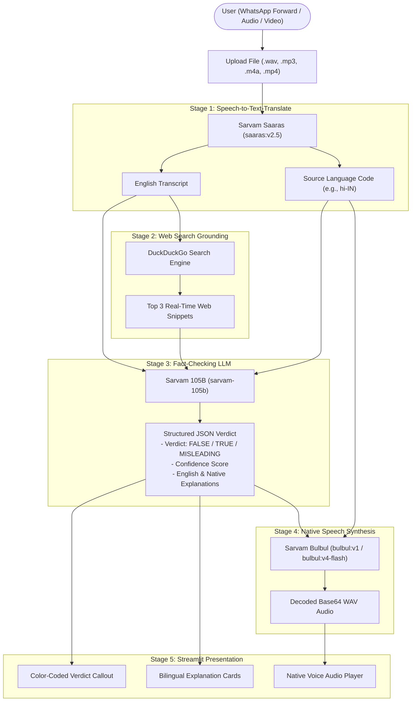
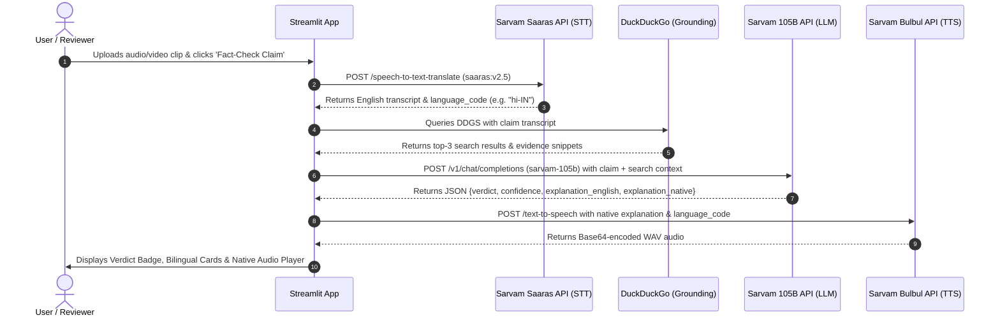

# 🔍 TruthLens Indic

> **AI-Powered Regional Audio Fact-Checker for WhatsApp Viral Claims**  
> *A high-impact hackathon MVP targeting regional-language misinformation across Indic languages.*

---

## 📌 Problem Statement

In India and multilingual regions, a vast portion of misinformation spreads via forwarded **WhatsApp voice notes**, **video snippets**, and **regional rumors** (Hindi, Tamil, Telugu, Bengali, Marathi, etc.). 

Most fact-checking tools assume users can read and type queries in English. Users receiving audio forwards often lack the digital literacy or search capabilities to verify claims. **TruthLens Indic** solves this by accepting regional audio or video forwards, verifying claims against live web sources with LLM reasoning, and delivering a verdict back in both visual badges and **native-language spoken audio**.

---

## 🚀 Key Features

- 🎙️ **Multimodal Media Ingestion**: Direct upload support for `.wav`, `.mp3`, `.m4a`, and `.mp4` audio/video clips.
- 🌐 **Sarvam Saaras STT & Translation**: Speech-to-Text and translation into English using `saaras:v2.5`, detecting the source BCP-47 language code (e.g., `hi-IN`, `ta-IN`, `te-IN`).
- 🔎 **Real-Time Web Search Grounding**: Live query grounding using DuckDuckGo to extract top-3 verified source snippets and context.
- 🧠 **Sarvam 105B Fact-Checking Reasoning**: Rigorous LLM verification enforcing structured JSON verdicts (`FALSE`, `TRUE`, `MISLEADING`), confidence scoring, and bilingual explanations.
- 🔊 **Sarvam Bulbul Native Voice Playback**: Generates high-fidelity native audio explanations in the user's original language using Sarvam's `bulbul:v1` (with `bulbul:v4-flash` fallback).
- ⚡ **Interactive Streamlit UI**: Step-by-step progress tracker (`st.status`), color-coded callouts, side-by-side bilingual cards, and embedded media players.

---

## 🏗️ Architecture & Workflow

### 1. End-to-End System Flowchart



---

### 2. Sequence Diagram



---

## 🛠️ Sarvam AI API Integration Matrix

| Workflow Stage | Endpoint | Model | Authentication Header | Purpose |
| :--- | :--- | :--- | :--- | :--- |
| **STT-Translate** | `POST https://api.sarvam.ai/speech-to-text-translate` | `saaras:v2.5` | `api-subscription-key` | Transcribes regional Indic audio directly into English and detects BCP-47 language. |
| **Grounding** | `DuckDuckGo Search Engine (DDGS)` | N/A | N/A | Fetches top real-time web citations and snippets to cross-check claim authenticity. |
| **Fact-Check LLM** | `POST https://api.sarvam.ai/v1/chat/completions` | `sarvam-105b` | `api-subscription-key` | Evaluates claim truthfulness, generates verdict, confidence, and bilingual explanations. |
| **TTS Native Audio** | `POST https://api.sarvam.ai/text-to-speech` | `bulbul:v1`<br/>*(fallback `bulbul:v4-flash`)* | `api-subscription-key` | Synthesizes native voice explanation in the user's regional dialect. |

---

## 📁 Project Structure

```text
sarvam-ai/
├── app.py              # Self-contained Streamlit application (Modules 1-6)
├── requirements.txt    # Project dependencies
├── .env                # Environment secrets (SARVAM_API_KEY) [git-ignored]
├── .gitignore          # Ignores .env, .venv, and build artifacts
└── README.md           # Documentation, architecture diagrams & usage guide
```

---

## ⚙️ Installation & Quickstart

### 1. Prerequisites
- Python 3.8+
- Active Sarvam AI API subscription key ([Sarvam Dashboard](https://dashboard.sarvam.ai))

### 2. Setup Environment
```bash
# Clone or navigate to the project directory
cd sarvam-ai

# Create and activate virtual environment
python3 -m venv .venv
source .venv/bin/activate       # On Linux/macOS
# .venv\Scripts\activate        # On Windows

# Install dependencies
pip install -r requirements.txt
```

### 3. Configure API Key
Create a `.env` file in the project root:
```env
SARVAM_API_KEY=your_sarvam_api_key_here
```
*(Alternatively, enter your key directly into the sidebar field inside the Streamlit app).*

### 4. Run the Application
```bash
streamlit run app.py
```
Open your browser at `http://localhost:8501`.

---

## 💡 Example Fact-Check Flow

1. **Input**: A 15-second WhatsApp voice forward in Tamil claiming a government pension deadline was moved up by 3 months.
2. **Saaras**: Transcribes and translates to English: *"The government announced that senior pension verification must be submitted by Friday or payments stop."* (`ta-IN`).
3. **Grounding**: DDG search retrieves official PIB (Press Information Bureau) fact-check and government notification circulars stating no deadline change occurred.
4. **Sarvam 105B**: Emits verdict:
   ```json
   {
     "verdict": "FALSE",
     "confidence": "HIGH",
     "explanation_english": "The Ministry has confirmed that pension verification dates remain unchanged. The viral circular circulating on social media is fabricated.",
     "explanation_native": "ஓய்வூதிய சரிபார்ப்பு தேதிகள் மாறவில்லை என்று அமைச்சகம் உறுதிப்படுத்தியுள்ளது. சமூக ஊடகங்களில் பரவும் சுற்றறிக்கை போலியானது."
   }
   ```
5. **Bulbul**: Plays the Tamil explanation back to the user instantly.
